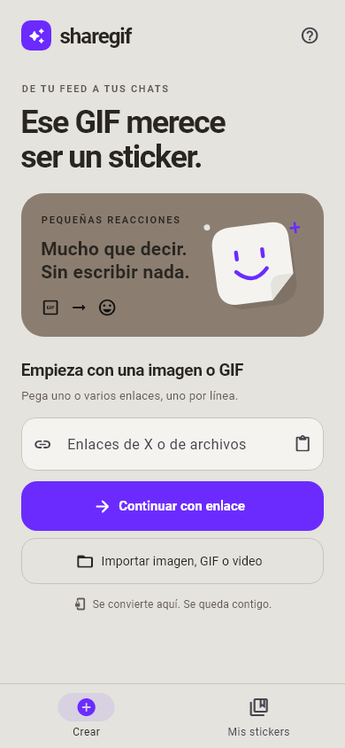
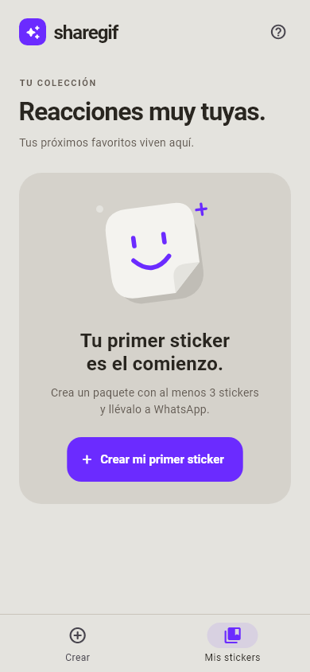

# ShareGIF

**De tu feed a tus chats.** Convierte imágenes, GIFs y videos en stickers de WhatsApp desde tu teléfono.

ShareGIF es una app Flutter con interfaz en español, conversión local y una colección privada de stickers. Puedes importar archivos del teléfono, pegar enlaces HTTPS directos o usar publicaciones públicas de X/Twitter. No necesita una cuenta de ShareGIF ni un servidor propio.

**Estado:** desarrollo para Android 7.0 o superior (API 24). La versión declarada en [pubspec.yaml](pubspec.yaml) es **0.1.3+4**. El código de iOS permanece en el repositorio, pero no forma parte de la plataforma validada actualmente. La incorporación final de paquetes a WhatsApp sigue pendiente de validación en un teléfono Android.

<p align="center">
  
  
</p>

<p align="center"><em>Referencias visuales de las pruebas de interfaz.</em></p>

## Qué puedes hacer

- Crear stickers estáticos desde PNG, JPG/JPEG y WebP estático, o animados desde GIF y video.
- Importar fotos, GIFs y videos de publicaciones públicas de X, incluidos adjuntos concretos y medios de publicaciones citadas cuando corresponde.
- Procesar hasta 30 enlaces distintos en secuencia, editando y guardando cada sticker antes de continuar.
- Elegir un fragmento de 0,2–10 segundos y un encuadre completo con espacio transparente o un recorte cuadrado al centro.
- Previsualizar el resultado, guardarlo en paquetes de imágenes o animaciones y eliminarlo de la colección local.
- Preparar paquetes de 3–30 stickers para añadirlos a WhatsApp en Android.

La conversión ajusta calidad y FPS automáticamente. Conserva la transparencia existente, pero no elimina fondos automáticamente.

## Crear tu primer paquete

1. En **Crear**, importa un archivo o pega un enlace y pulsa **Continuar con enlace**.
2. Ajusta el encuadre y, si es una animación, el fragmento. Pulsa **Crear sticker**.
3. Revisa la vista previa, elige o crea un paquete y pulsa **Guardar sticker**.
4. Repite hasta tener al menos tres stickers del mismo tipo.
5. Abre el paquete en **Mis stickers**, añádelo a WhatsApp y confirma allí la importación.

Consulta la [guía de uso](docs/USO.md) para conocer los formatos, límites, tandas de enlaces y soluciones a errores habituales.

## Ejecutar el proyecto

Necesitas Flutter con Dart compatible con `^3.14.0`, el SDK de Android, un JDK compatible con Gradle y un dispositivo Android o emulador. El entorno de referencia del proyecto es Flutter 3.50.0 / Dart 3.14.0 y Java 21; los pasos de configuración están en la [guía de desarrollo](docs/DESARROLLO.md).

```sh
git clone https://github.com/DonLuizKv/sharegif.git
cd sharegif
flutter doctor -v
flutter pub get
flutter devices
flutter run -d <ID_ANDROID>
```

Sustituye `<ID_ANDROID>` por el identificador de tu dispositivo. No se necesitan claves de API, archivos `.env` ni servicios externos propios. Para generar un APK de prueba:

```sh
flutter build apk --debug
```

El resultado se genera en `build/app/outputs/flutter-apk/app-debug.apk`. El build `release` todavía usa la firma de desarrollo: consulta la [lista previa a distribución](docs/DESARROLLO.md#antes-de-distribuir).

## Documentación

| Documento | Contenido |
| --- | --- |
| [Guía de uso](docs/USO.md) | Importación, edición, paquetes, privacidad y resolución de problemas. |
| [Desarrollo y verificación](docs/DESARROLLO.md) | Entorno, ejecución, compilación, pruebas y validación en Android. |
| [Arquitectura](docs/ARQUITECTURA.md) | Flujo de datos, conversión, almacenamiento e integración con WhatsApp y X. |
| [Contribuir](CONTRIBUTING.md) | Preparar cambios, reportar errores y mantener la documentación. |

## Privacidad y conexión

Los archivos se procesan en el teléfono. ShareGIF no incorpora analítica ni sube los archivos a un backend propio. Importar enlaces sí requiere conexión: el teléfono consulta X o el servidor del enlace y descarga el archivo. Una vez importado, la conversión es local. Al exportar, WhatsApp recibe acceso al paquete mediante el proveedor de contenido de Android.

La colección se guarda en el almacenamiento privado de la app; no hay sincronización ni recuperación desde una cuenta. Borrar los datos de ShareGIF o desinstalarla elimina su colección local.

## Verificación rápida

```sh
flutter analyze
flutter test
```

También hay verificaciones de conversión con FFmpeg del equipo y de importación real desde X. Sus requisitos y alcance se explican en [Desarrollo y verificación](docs/DESARROLLO.md#verificación). Las pruebas del equipo no sustituyen la comprobación del plugin nativo y la confirmación de WhatsApp en un teléfono.

## Licencias

El repositorio no incluye actualmente una licencia para el código de ShareGIF. La licencia de Roboto está en [assets/fonts/LICENSE.txt](assets/fonts/LICENSE.txt). La conversión usa `ffmpeg_kit_flutter_new_video`; antes de distribuir, deben revisarse las licencias de las dependencias y de los componentes nativos incluidos.
