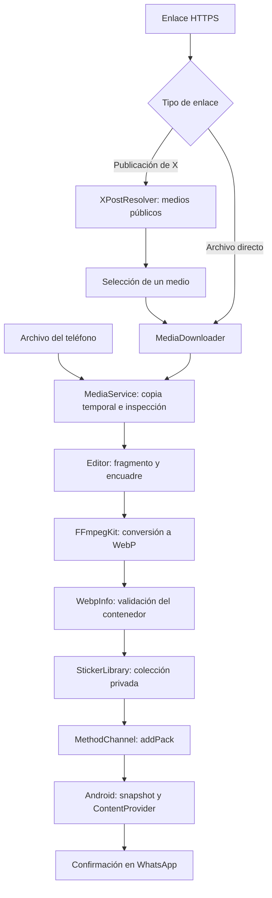

# Arquitectura

[Volver al README](../README.md) · [Desarrollo y verificación](DESARROLLO.md)

ShareGIF concentra la interfaz, la importación y la colección en Flutter. La conversión se ejecuta localmente mediante FFmpegKit y la entrega a WhatsApp usa un puente nativo. No hay backend propio.

## Flujo de un sticker



## Mapa del código

| Archivo | Responsabilidad |
| --- | --- |
| [lib/main.dart](../lib/main.dart) | Entrada de la aplicación. |
| [lib/src/app.dart](../lib/src/app.dart) | Crear, colección, tandas, selección de medios y vista del paquete. |
| [lib/src/editor.dart](../lib/src/editor.dart) | Fragmento, encuadre, conversión, vista previa y guardado. |
| [lib/src/theme.dart](../lib/src/theme.dart) | Paleta, tipografía, componentes e ilustraciones. |
| [lib/src/models.dart](../lib/src/models.dart) | Modelos, enlaces, argumentos de conversión y validación WebP. |
| [lib/src/link_batch.dart](../lib/src/link_batch.dart) | Validación y deduplicación de hasta 30 enlaces. |
| [lib/src/x_post_resolver.dart](../lib/src/x_post_resolver.dart) | Adaptador de respuestas públicas de X. |
| [lib/src/media_downloader.dart](../lib/src/media_downloader.dart) | Descarga HTTPS con límites y limpieza de archivos parciales. |
| [lib/src/services.dart](../lib/src/services.dart) | Inspección, conversión, persistencia, errores y canal de exportación. |
| [MainActivity.kt](../android/app/src/main/kotlin/com/sharegif/sharegif/MainActivity.kt) | Puente Flutter/Android e intent de WhatsApp. |
| [StickerProvider.kt](../android/app/src/main/kotlin/com/sharegif/sharegif/StickerProvider.kt) | Snapshots, manifiesto de exportación y proveedor de contenido. |
| [AppDelegate.swift](../ios/Runner/AppDelegate.swift) | Integración iOS existente, fuera del alcance de validación actual. |

## Importación y red

`MediaLink.parse` acepta HTTPS, rechaza credenciales incrustadas y distingue publicaciones de X de archivos directos. `PendingLink.parseBatch` valida toda la tanda antes de iniciar descargas. Para publicaciones, la clave de deduplicación combina ID y selección de adjunto; para enlaces directos usa la URI completa.

`XPostResolver` consulta `cdn.syndication.twimg.com/tweet-result` con el ID, idioma y un token calculado localmente. No usa claves de API ni cookies de una cuenta. Selecciona fotos de `pbs.twimg.com` y variantes MP4 de `video.twimg.com`; valida los hosts HTTPS de los medios resueltos. Una selección explícita nunca se sustituye silenciosamente por otro adjunto. Sin selección, busca en la cita solo cuando la publicación principal no aporta medios compatibles.

El endpoint no tiene un contrato público estable. La interpretación de sus respuestas está aislada para poder actualizarla y probarla con un transporte inyectado. Los errores de acceso, límites de consultas, JSON inválido y publicaciones sin medios se convierten en mensajes para el usuario.

`MediaDownloader` limita la entrada a 50 × 1024 × 1024 bytes tanto por `Content-Length` como durante la lectura. Controla redirecciones, exige HTTPS en cada solicitud, establece tiempos de espera y un plazo global de dos minutos. Escribe primero en `.part`, renombra al completar y elimina los parciales al salir. Los enlaces directos no se limitan a los hosts de X.

## Inspección y conversión

`MediaService` crea un directorio temporal por trabajo. Para imágenes reconocidas por su firma, usa el códec de Flutter con el lado mayor acotado a 2048 píxeles. Si hay un solo fotograma, genera un PNG intermedio para la conversión estática. Para animaciones y videos usa FFprobeKit, exige un flujo de video y una duración de 0,2 segundos a 10 minutos, y genera la miniatura inicial.

`ConversionOptions` construye los argumentos de FFmpeg:

- `contain`: escala conservando proporción y rellena con transparencia hasta 512 × 512.
- `cover`: escala conservando proporción y recorta el centro a 512 × 512.
- Imágenes: `libwebp`, un fotograma y hasta 100 × 1024 bytes.
- Animaciones: `libwebp_anim`, fragmento de hasta 10 segundos, bucle infinito y hasta 500 × 1024 bytes.

Se descartan audio y metadatos. La conversión prueba calidades 80, 60, 40, 25 y 10; para animaciones, primero a 15 FPS y luego a 10 FPS. Si no cabe, se pide otro fragmento o archivo. La miniatura de paquete se genera como PNG de 96 × 96 y hasta 50 × 1024 bytes.

`WebpInfo.validate` comprueba la estructura RIFF, tamaño declarado, dimensiones, chunks, fotogramas y duración; no confía solo en la extensión. El guardado y la exportación vuelven a validar los bytes y la coherencia entre el tipo de sticker y el paquete.

## Persistencia

La colección editable vive bajo `getApplicationDocumentsDirectory()/sharegif`:

```text
sharegif/
  library.json
  <pack-id>/
    tray.png
    <sticker-id>.webp
```

El índice serializa ID, nombre, tipo y lista de stickers; cada sticker contiene ID, peso y duración. Los paquetes antiguos sin `isAnimated` se interpretan como animados.

`StickerLibrary` limita la colección a diez paquetes, cada uno con hasta treinta stickers del mismo tipo. Escribe el índice en `library.json.tmp` y lo renombra antes de actualizar el estado en memoria. Si falla el guardado, intenta retirar el sticker copiado y no lo anuncia como guardado. Al borrar, confirma primero el índice; un fallo posterior al eliminar el archivo no restaura la entrada.

Los trabajos temporales se limpian al terminar su flujo. Los enlaces pendientes de una tanda pertenecen al estado de la pantalla y no se serializan con la colección.

## Exportación Android

`StickerLibrary.export` exige entre tres y treinta stickers, valida sus WebP y llama a `addPack` en el canal `sharegif/whatsapp`. Envía ID, nombre, tipo, rutas de archivos y una versión derivada de los IDs de stickers.

`MainActivity` busca primero `com.whatsapp` y después `com.whatsapp.w4b`. Prepara la exportación en un ejecutor y abre `com.whatsapp.intent.action.ENABLE_STICKER_PACK`. El resultado depende de la respuesta de la actividad de WhatsApp; cancelar o recibir un error no se trata como éxito.

`StickerStore` copia los recursos a `filesDir/whatsapp_packs/<id>_<digest>/` y actualiza `packs.json` mediante `AtomicFile`. El digest deriva de la versión y del tipo de paquete. El proveedor sirve metadatos y archivos de ese snapshot, por lo que la colección editable no es la fuente de lectura de WhatsApp. Las versiones previas de los directorios no se purgan al editar la colección.

La autoridad declarada es `${applicationId}.stickers`, con permiso de lectura `com.whatsapp.sticker.READ`. El proveedor implementa lectura de metadatos, listas y recursos; rechaza escritura. La preparación nativa comprueba que los archivos fuente pertenezcan al directorio privado de la app.

## Diseño

La paleta usa gris porcelana `#E4E3DE`, taupe `#8B7E71` y violeta `#6B2BFF`, con una proporción visual orientativa 60/30/10 y tonos derivados para texto. Roboto se incluye como recurso local. El editor se abre después de importar para mantener **Crear** centrado en la entrada de contenido.

Las imágenes de `test/goldens/` son referencias de pruebas. Si cambia intencionalmente la interfaz, revisa esas referencias y las capturas que utiliza el README.
